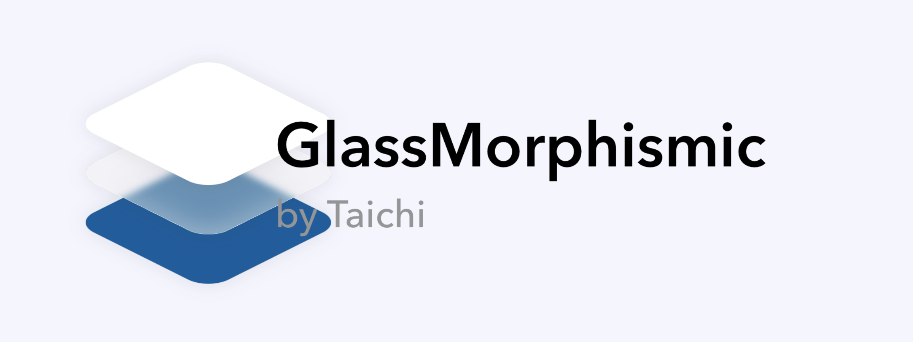

# GlassMorphismic



<p align="center">
  
  
  
</p>

## 概要

GlassMorphismicは、モダンなUIデザインのトレンドである「グラスモーフィズム（Glassmorphism）」をSwiftUIで簡単に実装できるライブラリです。半透明のガラス質な質感とぼかし効果を組み合わせた美しいビジュアルエフェクトを、わずか数行のコードで実現できます。

グラスモーフィズムは、2021年以降のUIデザインにおいて注目を集めているデザイン手法で、透明感のあるレイヤー、背景のぼかし、繊細な境界線を特徴としています。

## 特徴

- ✨ **簡単に使える** - わずか数行のコードで実装可能
- 🎨 **カスタマイズ可能** - 色、透明度、ぼかし効果などを自由に調整
- 🚀 **SwiftUI ネイティブ** - SwiftUIのView Modifierとして実装
- 📱 **マルチプラットフォーム対応** - iOS、macOS両方で動作
- ⚡ **軽量** - シンプルで効率的な実装

## 動作要件

- iOS 13.0以上
- macOS 10.15以上
- Swift 5.3以上
- Xcode 12.0以上

## インストール方法

### Swift Package Manager（推奨）

1. Xcodeでプロジェクトを開く
2. メニューバーから **File** → **Add Packages...** を選択
3. 右上の検索バーに以下のURLを入力：
   ```
   https://github.com/taichi-dm/GlassMorphismic
   ```
4. **Dependency Rule** で `main` ブランチを選択
5. **Add Package** をクリック
6. ターゲットプロジェクトを選択し、**Add Package** をクリック

### 手動でのPackage.swift設定

`Package.swift` ファイルに以下を追加：

```swift
dependencies: [
    .package(url: "https://github.com/taichi-dm/GlassMorphismic", .branch("main"))
]
```

## 使い方

### 基本的な使用例

まず、Swiftファイルの先頭でライブラリをインポートします：

```swift
import SwiftUI
import GlassMorphismic
```

最もシンプルな使用例：

```swift
struct ContentView: View {
    var body: some View {
        ZStack {
            // 背景
            LinearGradient(
                gradient: Gradient(colors: [.blue, .purple]),
                startPoint: .topLeading,
                endPoint: .bottomTrailing
            )
            .ignoresSafeArea()

            // グラスモーフィズム効果
            GlassMorphismic()
                .frame(width: 300, height: 200)
                .cornerRadius(20)
        }
    }
}
```

### カスタマイズ例

サイズや形状をカスタマイズ：

```swift
struct CustomGlassView: View {
    var body: some View {
        ZStack {
            Color.purple.ignoresSafeArea()

            GlassMorphismic()
                .frame(width: 350, height: 250)
                .cornerRadius(30)
                .shadow(color: .black.opacity(0.3), radius: 20, x: 0, y: 10)
        }
    }
}
```

### カード型UIの実装例

```swift
struct GlassCard: View {
    var body: some View {
        ZStack {
            // グラデーション背景
            LinearGradient(
                gradient: Gradient(colors: [
                    Color(red: 0.3, green: 0.5, blue: 0.9),
                    Color(red: 0.6, green: 0.3, blue: 0.8)
                ]),
                startPoint: .topLeading,
                endPoint: .bottomTrailing
            )
            .ignoresSafeArea()

            // グラスカード
            ZStack {
                GlassMorphismic()

                VStack(alignment: .leading, spacing: 16) {
                    Text("グラスモーフィズム")
                        .font(.title)
                        .fontWeight(.bold)

                    Text("美しい半透明のガラス質な質感を実現する\nモダンなデザイン手法")
                        .font(.body)
                        .opacity(0.8)

                    Spacer()

                    Button(action: {}) {
                        Text("詳しく見る")
                            .padding(.horizontal, 24)
                            .padding(.vertical, 12)
                            .background(Color.white.opacity(0.2))
                            .cornerRadius(10)
                    }
                }
                .padding(24)
                .foregroundColor(.white)
            }
            .frame(width: 320, height: 280)
            .cornerRadius(24)
            .shadow(color: .black.opacity(0.2), radius: 15, x: 0, y: 10)
        }
    }
}
```

## デザインのヒント

グラスモーフィズムを効果的に使用するためのポイント：

1. **背景に配慮する** - グラスモーフィズムは背景が透けて見えるため、カラフルな背景やグラデーションとの組み合わせが効果的です
2. **コントラストを意識する** - テキストや要素が読みやすいように、適切なコントラストを保ちましょう
3. **控えめに使う** - 過度に使用すると視覚的に煩雑になるため、アクセントとして活用するのがおすすめです
4. **シャドウを追加** - 軽いシャドウを追加することで、要素に深みと立体感が生まれます

## ライセンス

このプロジェクトはMITライセンスのもとで公開されています。詳細については [LICENSE](LICENSE) ファイルをご確認ください。

## 貢献

プルリクエストを歓迎します！バグ報告や機能要望がある場合は、Issueを作成してください。

## 作者

開発・メンテナンス: [taichi-dm](https://github.com/taichi-dm)

## 参考資料

- [Glassmorphism in user interfaces](https://uxdesign.cc/glassmorphism-in-user-interfaces-1f39bb1308c9)
- [SwiftUI Documentation](https://developer.apple.com/documentation/swiftui)

---

もしこのライブラリが役に立ったら、⭐️スターをつけていただけると嬉しいです！
